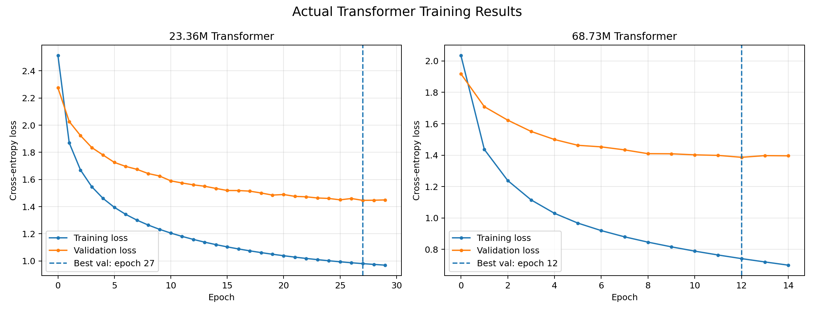

# English–Hindi Neural Machine Translation with a Transformer

An educational neural machine translation project built in PyTorch to study the Transformer architecture end to end. Two encoder–decoder models were trained from random initialization on the IIT Bombay English–Hindi parallel corpus. The project focuses on implementing the core architecture, building a translation data pipeline, training under limited GPU resources.

> **Project status:** Experimental learning project. The models demonstrate a working training and inference pipeline, but their translation quality is not sufficient for real-world use.

## 1. Project at a glance

| Item | Details |
|---|---|
| Task | English → Hindi neural machine translation |
| Dataset | [IIT Bombay English–Hindi Parallel Corpus](https://huggingface.co/datasets/cfilt/iitb-english-hindi) |
| Framework | PyTorch |
| Tokenizer | Shared Byte-Level BPE tokenizer |
| Vocabulary | 16,000 tokens |
| Special tokens | `<PAD>=0`, `<BOS>=1`, `<EOS>=2`, `<UNK>=3` |
| Maximum sequence length | 160 tokens, including special tokens |
| Hardware | NVIDIA Tesla T4 GPU (~15 GiB VRAM) |
| Model family | Encoder–decoder Transformer, trained from scratch |

## 2.Installation

### 1. Clone the Repository

```bash
git clone https://github.com/deviprasadbrl/english-hindi-transformer-from-scratch.git
cd english-hindi-transformer-from-scratch
```

### 2. Install Dependencies

Install the required Python packages:

```bash
pip install -r requirements.txt
```

For GPU training, install a PyTorch build compatible with your CUDA environment using the [official PyTorch installation guide](https://pytorch.org/get-started/locally/).

### 3. Download and Prepare the Dataset

This project uses the [IIT Bombay English–Hindi Parallel Corpus](https://huggingface.co/datasets/cfilt/iitb-english-hindi).

The dataset is not included in this repository. Download it using Hugging Face Datasets or follow the instructions in the project's data pipeline. The dataset must be prepared in the format expected by the training scripts.

### 4. Configure Dataset and Checkpoint Paths

This project was developed and trained in Kaggle Notebooks. Some paths may therefore refer to Kaggle-specific directories, such as `/kaggle/input/` and `/kaggle/working/`.

Before running training or inference, ensure that the dataset, tokenizer, and checkpoint paths match your environment. The default paths are defined in `paths.py`.

### 5. Select a Model Configuration

Two Transformer configurations are provided:

| Configuration | Parameters | Model Dimension | Feed-Forward Dimension | Batch Size |
|---|---:|---:|---:|---:|
| `CONFIG_23M` | 23.36M | 256 | 1,024 | 128 |
| `CONFIG_68M` | 68.73M | 512 | 2,048 | 64 |

To select the smaller model, use the following configuration in your training script:

```python
from config import CONFIG_23M

config = CONFIG_23M
```

To select the larger model instead:

```python
from config import CONFIG_68M

config = CONFIG_68M
```

Ensure that the selected configuration is passed to the model and training components. These configurations define the model and training settings; they do not include trained model weights.

### 6. Train the Model

After preparing the dataset and verifying the paths, run:

```bash
python training.py
```

Make sure `training.py` uses the intended configuration and that all required data files are available before starting training.

> **Note:** Both models were trained from scratch. Training requires substantial compute resources and may take many hours. The experimental results reported in this README correspond to the completed training runs, not necessarily a new run using the instructions above.

## 3. Dataset and preprocessing

The project uses the IIT Bombay English–Hindi parallel corpus, which contains aligned English and Hindi sentences collected from multiple sources. The tokenizer is shared between the two languages and uses byte-level BPE, allowing text to be represented as subword tokens rather than requiring a separate word-level vocabulary for each language.

## Downloading the dataset

Install the dataset library:

```bash
pip install datasets
```

Then run:

```python
from datasets import load_dataset

dataset=load_dataset("cfilt/iitb-english-hindi")

print(dataset)
print(dataset["train"][0]["translation"])
```

The dataset contains `train`,`validation`,and `test` splits. Each example contains a `translation` field with `en` and `hi` text. The expected access pattern is:

```python
example = dataset["train"][0]["translation"]
english_text=example["en"]
hindi_text=example["hi"]
```

Use the dataset's official page for details and any dataset-specific terms: [IIT Bombay English–Hindi on Hugging Face](https://huggingface.co/datasets/cfilt/iitb-english-hindi).

**Project integration note:** The code above downloads the raw Hugging Face dataset. Your project's preprocessing/data-pipeline code may perform additional cleaning, filtering, or conversion before training. Follow the repository's data-pipeline configuration for the exact paths and preprocessing steps; do not assume the raw dataset is already in the project's processed format.

The token-length statistics below were recorded before the final length filtering. Lengths refer to tokenizer tokens, not words.

| Split | Language | Pairs/sentences | Mean | Median | P95 | P99 | Maximum |
|---|---|---:|---:|---:|---:|---:|---:|
| Train | English | 1,659,083 | 19.74 | 14 | 54 | 92 | 3,228 |
| Train | Hindi | 1,659,083 | 49.65 | 33 | 147 | 246 | 5,337 |
| Validation | English | 520 | 26.44 | 24 | 50 | 67.81 | 105 |
| Validation | Hindi | 520 | 61.91 | 57 | 118 | 160.86 | 219 |
| Test | English | 2,507 | 30.31 | 28 | 58 | 73.94 | 133 |
| Test | Hindi | 2,507 | 79.22 | 71 | 158 | 206.88 | 293 |

### Why limit sequences to 160 tokens?

A maximum length of 160 was a practical trade-off between coverage and compute cost. It is above the training Hindi 95th-percentile length (147 tokens), while remaining below the 99th percentile (246 tokens). This retains many ordinary examples while limiting the memory and attention computation required by long sequences. The trade-off is that some long examples are truncated or excluded, depending on the preprocessing pipeline. BOS and EOS tokens count toward the maximum length.

The final test loader retained **2,394 of 2,507** test pairs after filtering. The validation length report contains 520 examples before filtering. Dataset counts can differ between raw data, cleaned data, and the final loader; therefore, the exact retained training count should be taken from the final preprocessing run rather than inferred from the raw corpus count.

## 4. Model architecture

Both experiments use the original encoder–decoder Transformer design introduced in *Attention Is All You Need*.

- **Encoder:** six layers of self-attention and feed-forward processing build contextual representations of the English source sentence.
- **Decoder:** six layers use causal self-attention over previously generated Hindi tokens, then cross-attention over the encoder output.
- **Multi-head attention:** allows attention to be computed across multiple learned representation subspaces.
- **Position information:** positional encoding supplies token-order information because the model does not use recurrence.
- **Feed-forward networks:** process each position's representation between attention sublayers.
- **Residual connections, layer normalization, and dropout:** support optimization and regularization.
- **Masks:** source/target padding masks prevent attention to padding positions; causal masking prevents the decoder from seeing future target tokens during training.

The core attention and Transformer components were implemented with standard PyTorch tensor operations. This was an implementation-focused project rather than a wrapper around a pretrained translation model.

## 5. Why FlashAttention was not used

FlashAttention is an optimized exact-attention implementation designed to reduce high-bandwidth-memory traffic and improve attention efficiency. It is not a different attention objective; it computes the same attention result using a more memory-efficient implementation.

For this project, attention was implemented explicitly with standard PyTorch operations for transparency and to make the tensor shapes, masks, and attention calculations easier to inspect while learning. The available T4/software environment also constrained which optimized kernels could be used conveniently. FlashAttention support depends on the specific package version, CUDA/PyTorch build, data type, and GPU architecture, so it would be inaccurate to claim that every FlashAttention version is categorically impossible on a T4.

The trade-off is that the explicit implementation can use more intermediate memory and can be slower than a compatible fused attention kernel. Using FlashAttention could be a useful future optimization, but it was not required to validate the model's architecture or training pipeline.

## 6. Training setup

The models were trained from random initialization using teacher forcing. During training, the decoder receives the target sequence shifted right (`tgt[:, :-1]`) and predicts the next tokens (`tgt[:, 1:]`). Cross-entropy loss ignores padding tokens.

| Setting | Value |
|---|---|
| Optimizer | AdamW |
| Learning rate | `3e-4` |
| Weight decay | `0.01` |
| Dropout | `0.1` |
| Gradient clipping | `1.0` |
| Learning-rate schedule | Cosine schedule |
| Precision | CUDA FP16 mixed precision |
| Gradient accumulation | 2 steps |
| Training objective | Next-token cross-entropy, ignoring PAD |
| Inference | Autoregressive decoding with beam search |
| Beam size / length penalty | `4` / `0.7` |

## 7. Experiments and results

| Metric | 23.36M-parameter Transformer | 68.73M-parameter Transformer |
|---|---:|---:|
| Model parameters | 23,364,224 | 68,732,544 |
| `d_model` | 256 | 512 |
| Feed-forward dimension | 1,024 | 2,048 |
| Encoder / decoder layers | 6 / 6 | 6 / 6 |
| Attention heads | 8 | 8 |
| Batch size | 128 | 64 |
| Completed epochs | 30 | 15 |
| Best validation loss | 1.4464 (epoch 27) | 1.3864 (epoch 12) |
| Approximate training time | 27 hours | 25.6 hours |
| Test examples evaluated | 2,394 | 2,394 |
| Corpus BLEU | 6.78 | 7.74 |

The larger model achieved a best validation loss lower by **0.0600** and corpus BLEU higher by **0.96 points**. This comparison is informative but not a perfectly controlled parameter-only experiment: the batch sizes and number of completed epochs differed, and the models had different training trajectories. The BLEU scores are reported on the same filtered test set using beam size 4 and length penalty 0.7; BLEU is a corpus-level metric and should not be interpreted as a percentage of translations that are correct.

### Training and validation loss graphs

<p align="center">
  
</p>


## 8. Translation examples and qualitative analysis

The examples below compare the reference translation with each model's generated output. They illustrate that the models learned some English–Hindi correspondences, but still struggle with context, word order, meaning preservation, and fluent Hindi. The reference is from the dataset and should not be treated as the only possible valid translation in every case.

### Example 1 — Short phrase with a concrete noun

**English source:** `A black box in your car?`

- **Reference:** आपकी कार में ब्लैक बॉक्स?
- **68.73M model:** कार में ब्लैक बक्सा?
- **23.36M model:** काले बॉक्स में एक काला बॉक्स?

### Example 2 — Idiom and implied reaction

**English source:** `The tea party is aghast.`

- **Reference:** चाय पार्टी भौचक्की है।
- **68.73M model:** चाय पार्टी है।
- **23.36M model:** चाय पार्टी एक चाय है।
- 
### Example 3 — Longer sentence and meaning preservation

**English source:** `This really is a must for our nation.`

- **Reference:** यह हमारे देश के लिए वास्तव में अनिवार्य वस्तु है।
- **68.73M model:** यह वास्तव में हमारे देश के लिए एक राष्ट्र होना चाहिए।
- **23.36M model:** यह वास्तव में हमारे राष्ट्र के लिए आवश्यक है।

### Example 4 — Long sentence with complex syntax

**English source:** `There is going to be a change in how we pay these taxes.`

- **Reference:** हमारे द्वारा कर भुगतान किए जाने के तरीके में परिवर्तन होने जा रहा है।
- **68.73M model:** इन करों में कैसे बदलाव करने के लिए जा रहा है।
- **23.36M model:** हम इन करों में एक परिवर्तन होने जा रहे हैं।

### What these examples suggest

The larger model performs better on corpus BLEU and validation loss overall, but the qualitative examples show that both models can omit important information, misinterpret expressions, or produce ungrammatical Hindi. The outputs are useful diagnostic evidence, not proof of production-level translation quality.

## 9. Limitations

1. **Low translation quality:** corpus BLEU values of 6.78 and 7.74 indicate that these models remain far from reliable general-purpose translators.
2. **Limited compute budget:** training was conducted on a single Tesla T4-class GPU, constraining batch size, training duration, and the scale of experiments.
3. **Sequence-length filtering:** a 160-token limit reduces compute cost but excludes or truncates some long examples and may disproportionately affect long Hindi translations.
4. **Training not fully matched:** the two model runs differ in batch size and completed epochs, so the result does not isolate parameter count as the only variable.
5. **Evaluation coverage:** the final test loader contains 2,394 examples after filtering, not all 2,507 reported raw test examples.
6. **Metric limitations:** BLEU measures n-gram overlap and cannot fully capture meaning, fluency, or all valid alternative translations.
7. **Domain and data limitations:** the corpus combines data from varied sources, and the model may not generalize well to domains or sentence styles that are underrepresented in training.
8. **No pretrained knowledge:** both models were trained from random initialization; they do not benefit from a pretrained language model or a pretrained translation system.

## 10. Lessons learned

- A functioning Transformer requires more than the attention equations: correct target shifting, padding masks, causal masks, cross-attention masks, and decoding behavior are all important.
- Validation loss and BLEU provide different views of performance; neither replaces qualitative inspection.
- More parameters can improve aggregate metrics without guaranteeing better output for every sentence.
- Sequence-length limits should be selected from token-length statistics and available compute, with the resulting coverage trade-off documented.
- Optimized kernels can improve efficiency, but a transparent baseline is valuable when the goal is to understand and validate the implementation.
- Reproducible reporting requires distinguishing raw dataset sizes from filtered loader sizes and clearly stating when experiments differ in more than one variable.

## 11. References

1. Vaswani, A., Shazeer, N., Parmar, N., Uszkoreit, J., Jones, L., Gomez, A. N., Kaiser, Ł., & Polosukhin, I. (2017). **Attention Is All You Need.** *Advances in Neural Information Processing Systems 30 (NeurIPS 2017).* [arXiv:1706.03762](https://arxiv.org/abs/1706.03762).
2. Dataset repository: [cfilt/iitb-english-hindi on Hugging Face](https://huggingface.co/datasets/cfilt/iitb-english-hindi).

## 12. Reproducibility note

This README reports the configurations and metrics recorded during the experiments. Before treating the project as a fully reproducible release, include the training and inference scripts, tokenizer files/configuration, dependency versions, and exact preprocessing commands in the repository. Verify the final retained training-set count from the actual data pipeline before publishing it; intermediate notes contained different counts from different processing stages.

---

# Author

**Devi Prasad BRL**

[GitHub](https://github.com/deviprasadbrl)

---
